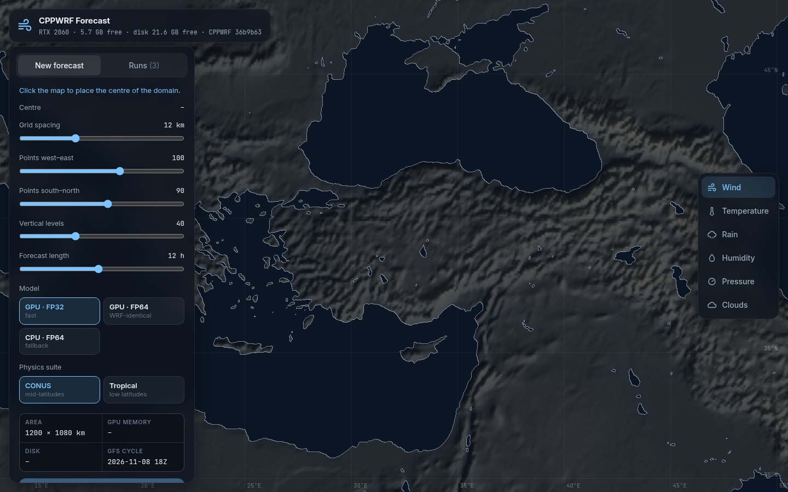
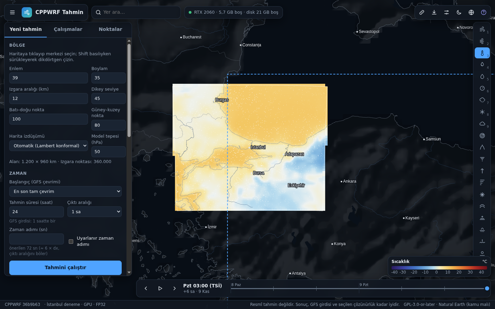
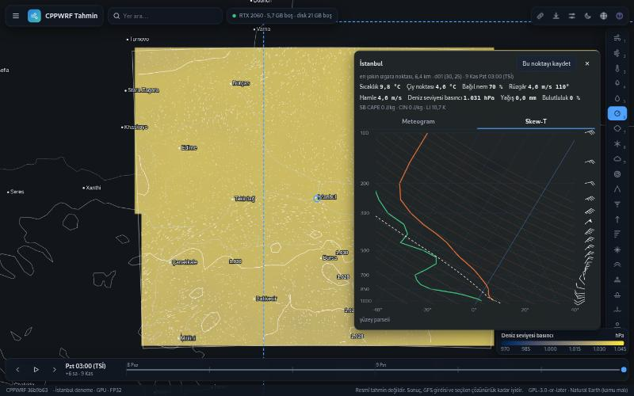

# WEB2 progress

## M1 — foundation (2026-11-09)

**Works**
- CPPWRF submodule moved from v1.0.0 (e849149) to 36b9b63, which fixes the nvcc 12.4 range-for error upstream.
  Patch 0002 and the overlay copy are gone; 0001 stays as a suggestion.
- `tools/build_all.sh` builds `build/cpu-fp64` (cppwrf + cppwrf_real), `build/gpu-fp32`, `build/gpu-fp64` and the
  server, one at a time, `nice -n 10`, `-j6`, compute capability from nvidia-smi (7.5 here), no floating-point
  flags. Times on this machine: 69 s, 142 s, 238 s.
- `forecast/prepare.py`: the settings schema (unknown keys and out-of-range values are errors), the derived values
  (projection by latitude, levels, time step 6·dx, GFS hours and region), the WPS and WRF namelists, the
  translator check (`tools/wrf2cppwrf.py` from the submodule; its `[ERROR]` lines are mapped to the setting they
  are about, with a Turkish explanation), the cost estimate and the warning level (green / yellow / red, with the
  cheapest change that makes a red run fit).
- The server (`forecast/server/server.cpp`) rebuilt: `/api/v1` (system, options, cycles, estimate, runs, run,
  delete, cancel, star, events as Server-Sent Events, logs, products, wrfout files), a queue with one run at a
  time, `run.json` per run (settings, mode, CPPWRF commit, estimate, actual numbers), programs started with
  execvp and argument arrays, 64 KB request limit, file paths built from checked run ids and names, cancel by
  SIGTERM then SIGKILL to the process group, partial files removed, orphaned runs found and stopped at start-up.
- GitHub Pages: the owner wants the site on Pages too. The server answers CORS and Private Network Access
  preflights for `https://xassemblianist.github.io` only; POST / DELETE from any other foreign origin get 403.
- The page from the first local forecast milestone talks to `/api/v1` and shows "CPPWRF 36b9b63"; the new
  viewer is M4.

**Measured** (the same case through the API in all three modes: Ankara, 40 × 36 × 35, 15 km, 3 h, P4 physics,
GFS 2026-11-08 18Z, hourly input)

| Mode | stepping | ns/cell/step | GPU memory | whole run |
|---|---|---|---|---|
| GPU FP32 | 1.48 s | 244 | 1075 MiB | 70 s |
| GPU FP64 | 3.42 s | 565 | 1757 MiB | 71 s |
| CPU FP64 (6 threads) | 13.46 s | 2226 | – | 82 s |

The GFS download (4 files from NOMADS) took 64 s of each run. **The GPU FP64 wrfout files equal the CPU FP64
files byte for byte** (`cmp`, all 4 output times).

## M2: free settings and the estimate panel (2026-11-09)

**Works**

- The new page (`forecast/web/index.html`, `css/app.css`, `js/*.js`; plain ES modules, nothing vendored, no CDN).
  "Yeni tahmin" has the region (click for the centre, Shift-drag for a rectangle, the domain previewed on the map),
  dx 1–50 km, 20–1000 points each way, 30–100 levels, the projection chosen from the latitude with an override,
  the model top, the GFS cycle (latest complete or any of the last eight days), 1–384 h, the output interval,
  the time step, the adaptive step, a nest (drawn with Shift-drag inside the parent, ratio 1:3 or 1:5, one- or
  two-way), a preset and every option the submodule's translator supports, grouped, with Turkish labels and tips.
- The estimate panel follows every change (debounced POST `/api/v1/estimate`): the stages as a bar and a table,
  GPU memory, RAM and disk against what is free (meters turn yellow above 70 %), the GFS download, the frames,
  the finish time in TSİ, the same settings in the other two modes, the calibration it came from. Translator and
  schema errors appear under the control they are about (an error in the advanced options opens that section).
  Yellow asks "Uzun sürecek, devam etmek istiyor musun?" before starting; red disables the button and shows the
  cheapest change that fits.
- During a run: a progress card fed by Server-Sent Events (stage strip, percent, elapsed, simulated time, steps per
  second, times real time, remaining model time, the log tail of the stage, "İptal"), the frames wrfpost has
  finished can be opened while the model still runs, a browser notification when it ends in a background tab.
- "Çalışmalar": every run with mode, grid, physics, CPPWRF commit, estimate against actual, disk use, star,
  delete, run again, change and run.

**Fixed on the way**

- The suggested time step (6·dx) did not divide the output interval at 9 km (54 s against 3600 s), which the
  translator refuses. It is now the largest divisor of the output interval not above 6·dx (50 s at 9 km).
- `pipeline.sh` wrote the stage times with a decimal comma under the Turkish locale (`103,80`); it now runs with
  `LC_ALL=C`.
- Stored settings could not be sent again (a fixed dynamics value echoed back was an unknown key).
- The run status during a run is `running` with the stage beside it.

**Measured** (İstanbul, 60 × 50 × 40, 9 km, 6 h, P4 physics, GPU FP32, 7 GFS files, started from the page)

| Stage | estimate | actual |
|---|---|---|
| GFS download | 107.1 s | 103.8 s |
| geogrid + ungrib + metgrid | 3.7 s | 2.9 s |
| real | 1.1 s | 0.8 s |
| model | 10.7 s | 10.2 s |
| products | 0.2 s | 0.7 s |
| **total** | **122.9 s** | **118.4 s (−3.7 %)** |

GPU memory: estimated 1476 MiB, measured 1319 MiB. Three frames were on the map before the model ended.

## M3: wrfpost products and tests (2026-11-09)

**Works**

- `wrfpost` writes, per domain and frame, 33 surface fields (10 m wind, gusts, 2 m temperature, dew point and
  RH, MSLP, surface pressure, precipitation rate and accumulation, rain, snow, graupel, convective and grid-scale,
  low / mid / high / total cloud, SB and MU CAPE and CIN, lifted index, 0–6 km shear, snow depth, soil moisture,
  skin temperature, SST, freezing level, PBL height, radar reflectivity) and u, v, T, Td, RH, z at 925, 850, 700,
  500, 300 and 250 hPa, plus 21-level soundings and, at the end, the point time series for the meteogram.
  The methods are in `forecast/server/postcore.hpp` and in `meta.json` of every run.
- Frames are processed in parallel (a pool of 4 threads) while the model writes them (`--follow`).
- The point card: the values at the model's nearest grid point, a meteogram (temperature and dew point, wind and
  gusts with direction arrows, precipitation with snow, pressure and cloud cover in three bands) and a Skew-T
  (temperatures, dry and moist adiabats, the surface parcel, wind barbs).
- `tests/post_tests.cpp` (`build/forecast/post_tests`): 19 checks against closed forms: ln p interpolation,
  the MSLP of the ICAO standard atmosphere over 1500 m ground (101 323 Pa against 101 325 Pa), dew point,
  θe along the pseudoadiabat, CAPE of a stable column (0), CAPE of a column with constant buoyancy
  (Rd·ΔT·ln(p1/ptop) = 1307.33 J/kg, exact), CIN and CAPE under a cap (−117.2 and 1247.9 J/kg, exact), gusts.
  MetPy is not installed here, so it is not the reference.

**Fixed on the way**

- `wrfpost --follow` read the first wrfout while the model was still writing it; the NetCDF error then ended the
  program through `std::terminate` (threads not joined). Files are read only once the next one exists, and the
  workers are joined however the program leaves.

