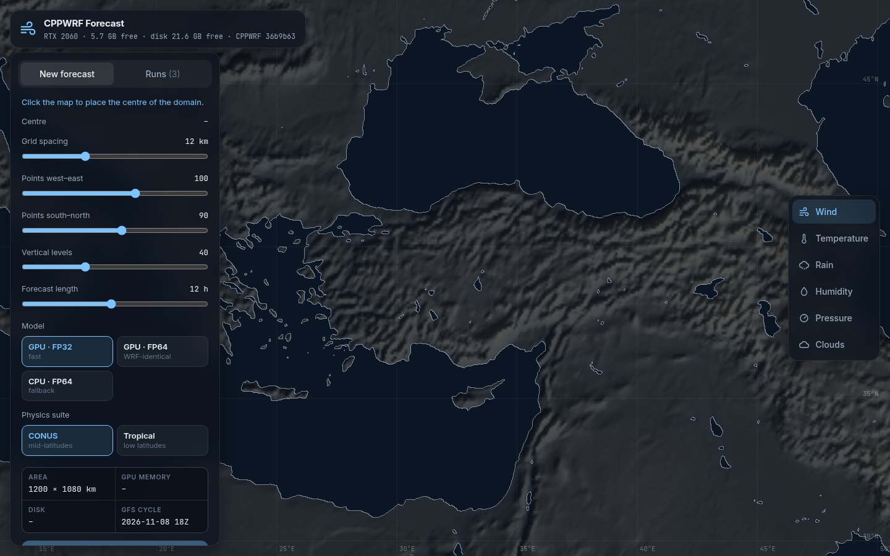
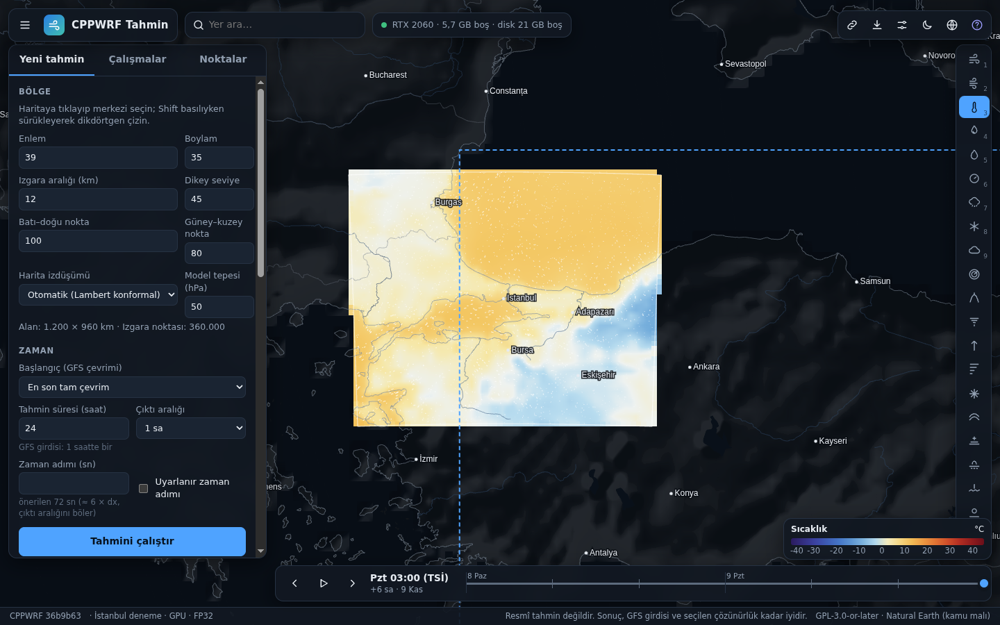
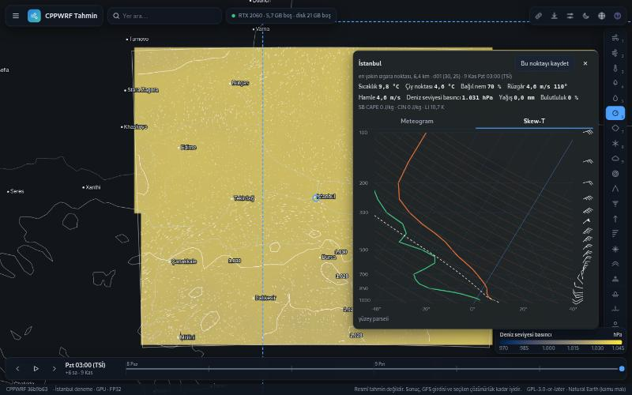
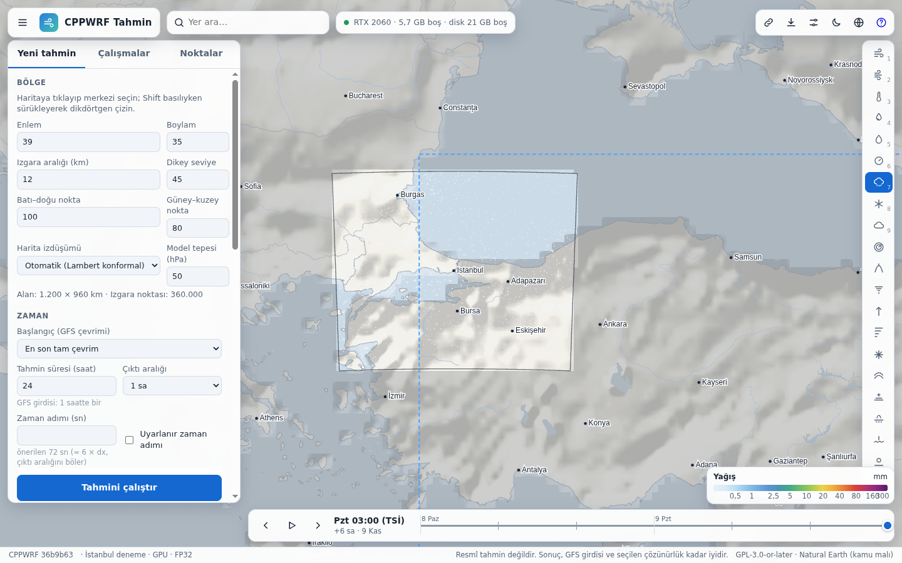
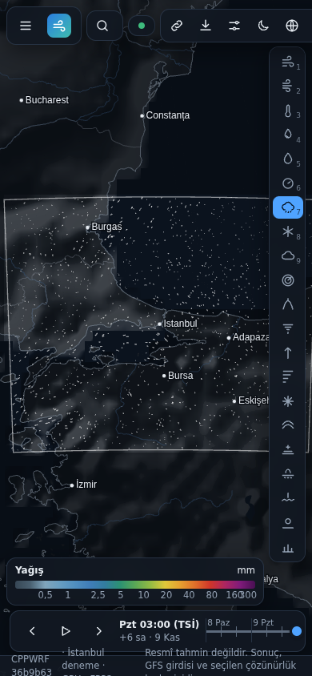
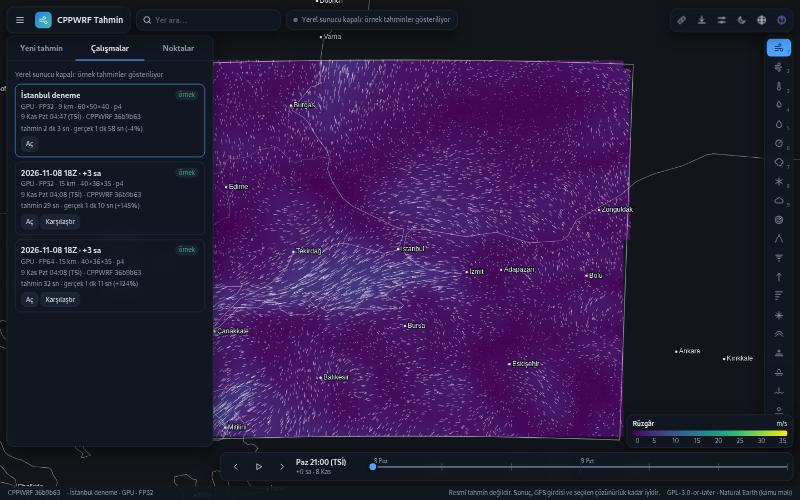
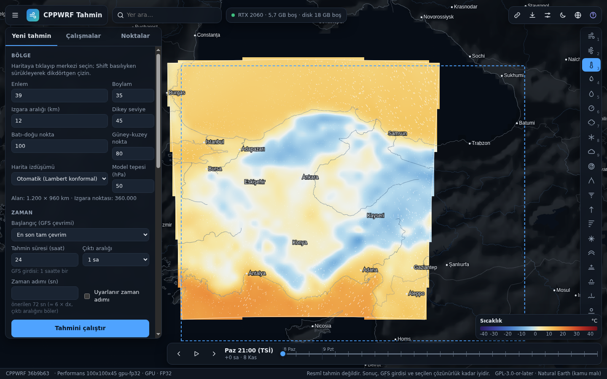
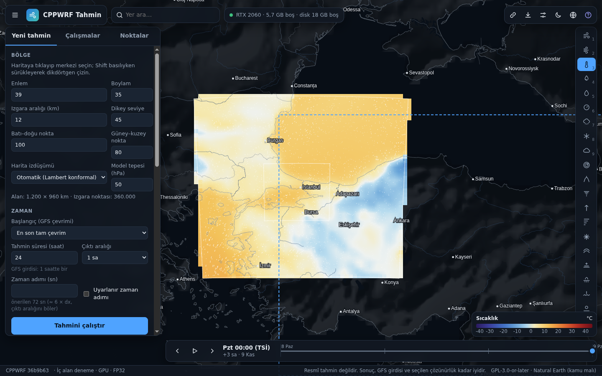

# WEB2 report: the CPPWRF forecast site

WEB2 is a Turkish weather-forecast site that runs real-data CPPWRF forecasts on this machine and shows them on a
WebGL2 map. It works locally on `http://127.0.0.1:8090/` and on GitHub Pages: there it uses the visitor's local
server when one answers, and shows published sample forecasts otherwise. Machine: NVIDIA GeForce RTX 2060
(6 GB, compute capability 7.5), 12 CPU threads (6 used by OpenMP), 16 GB RAM. CPPWRF 36b9b63 (submodule, unmodified).
Day-by-day notes and screenshots: [WEB2_progress.md](WEB2_progress.md).

## Milestones

| | Status | Commit |
|---|---|---|
| M1: submodule at 36b9b63, three builds, the `/api/v1` server with a run queue | done | 452107f |
| M2: free settings, the estimate panel, progress over Server-Sent Events | done | 09a8aed |
| M3: wrfpost products (33 surface fields, 6 levels, soundings, series) and tests | done | 09a8aed |
| M4: the Turkish WebGL2 viewer, comparison, export, themes, phone layout, Pages samples | done | 8fd3674 |
| M5: end-to-end test, failure handling, performance, docs | done | fe7165c |

## Performance on the RTX 2060

The same case in the three modes, started by `tools/e2e.sh --case perf`: central Turkey, 100 × 100 × 45 points,
9 km, 24 h, P4 physics (WSM6, Kain-Fritsch, YSU, Noah, RRTMG every 9 min), GFS 2026-11-08 18Z hourly (25 files),
time step 50 s (1728 steps), hourly output (25 frames).

| Stage (s) | GPU FP32 | GPU FP64 | CPU FP64 (6 threads) |
|---|---|---|---|
| GFS download (25 files, NOMADS) | 395.9 | 422.9 | 402.4 |
| geogrid / ungrib / metgrid | 0.4 / 2.0 / 11.8 | 0.4 / 2.0 / 11.6 | 0.4 / 2.1 / 12.1 |
| real | 5.5 | 5.6 | 5.4 |
| **model** | **124.6** | **306.5** | **1927.0** |
| of which stepping | 104.6 | 262.7 | 1912.7 |
| products (while the model runs; the tail after it) | 0.8 | 1.0 | 1.0 |
| **total** | **540.9** | **750.1** | **2350.4** |
| ns per cell and step | 134.6 | 337.9 | 2459.7 |
| simulated time / model time | 694× | 282× | 45× |
| GPU memory (device total) | 2383 MiB | 3469 MiB | – |
| disk of the finished run | 0.83 GB | 1.31 GB | 1.31 GB |

GPU FP32 steps 18× faster than the CPU, GPU FP64 7.3×. The download is the largest part of a short run on a GPU.

### The largest grid of each mode

Found by the estimator (45 levels, 15 km, 3 h), then run:

| Mode | Largest grid | Cells | GPU memory used | Model | Whole run |
|---|---|---|---|---|---|
| GPU FP32 | 245 × 245 × 45 | 2.70 M | 5013 of 5920 MiB | 48.3 s | 140 s |
| GPU FP64 | 154 × 154 × 45 | 1.07 M | 5171 of 5920 MiB | 45.4 s | 120 s |
| CPU FP64 | 217 × 217 × 45 (estimate, limited by RAM: ~7.5 GB of 7.4 GB free) | 2.12 M | – | not run | – |

The GPU limit depends on the length too: every input time of the lateral boundaries is held on the device (about
1.6 KiB per boundary point and time in FP32), so a 24 h run fits a somewhat smaller grid than a 3 h run.

### The page

| Renderer | Wind particles running | While panning and zooming |
|---|---|---|
| WebGL2 on the Intel UHD (CML GT2) through ANGLE / OpenGL ES, headless Chrome | 58 fps | 30 fps |
| 2-D canvas fallback (no WebGL2) | 60 fps | 33 fps |
| WebGL2 on SwiftShader (CPU) | 4 fps | 1 fps |

Measured on the 100 × 100 run's wind layer (102 × 107 latitude-longitude grid, 6887 particles) at 1440 × 900 by
`tools/page_fps.mjs`. Headless Chrome did not use the RTX 2060 (its Vulkan path fell back to no WebGL); a desktop
Chrome would.

## Estimate accuracy

Estimates as the page showed them before the run, against the actual numbers:

| Run | Total: estimate / actual | Model: estimate / actual | GPU memory: estimate without the 10 % margin / actual |
|---|---|---|---|
| İstanbul 60 × 50 × 40, 9 km, 6 h, FP32 | 122.9 / 118.4 s (+3.8 %) | 10.7 / 10.2 s | 1342 / 1319 MiB |
| 100 × 100 × 45, 24 h, FP32 | 507 / 541 s (−6.3 %) | 94.1 / 124.6 s (−24 %) | 2295 / 2383 MiB |
| 100 × 100 × 45, 24 h, FP64 | 656 / 750 s (−12.5 %) | 243.1 / 306.5 s (−21 %) | 3403 / 3469 MiB |
| 100 × 100 × 45, 24 h, CPU FP64 | 2157 / 2350 s (−8.2 %) | 1744 / 1927 s (−9.5 %) | – |
| 245 × 245 × 45, 3 h, FP32 (after the memory refit) | 146 / 140 s (+4.0 %) | 41.8 / 48.3 s | 5234 / 5013 MiB (+4.4 %) |
| 154 × 154 × 45, 3 h, FP64 (after the memory refit) | 115 / 120 s (−3.6 %) | 43.5 / 45.4 s | 5258 / 5171 MiB (+1.7 %) |

Totals were within 13 %. The model time of large GPU grids was underestimated by about a fifth: the calibration
(`tools/calibrate.sh`) measures two small grids, and the GPU is less efficient per cell there than the line
through them assumes. Every finished run moves the coefficients (log-space average, weight 0.3), so this shrinks.
The first memory model (a + b · cells, moved by the same average) estimated 172 × 172 × 45 at 5.3 GB where it used
3.1 GB; the boundary term and a least-squares refit after every run fixed that.

## The FP64 identity

**GPU FP64 writes the same wrfout files as CPU FP64, byte for byte.** Checked by `tools/e2e.py` with
`filecmp.cmp(shallow=False)` on every output file:

| Case | Files | Identical |
|---|---|---|
| Ankara 40 × 36 × 35, 15 km, 3 h (M1) | 4 | 4 |
| 100 × 100 × 45, 9 km, 24 h, 1728 steps (M5) | 25 | 25 |

CPU FP64 is CPPWRF's native build, bit-identical to WRF real*8 (CPPWRF's own tests). The GPU FP64 build gets there
because CPPWRF's CMake compiles the CUDA kernels with `--fmad=false` and glibc's math functions; this repository
adds no floating-point flag.

GPU FP32 against GPU FP64 after 24 h (`tools/ncdiff`, last frame, relative L2 = ‖A − B‖ / ‖B‖):

| U | V | W | T | PH | QVAPOR | MU | PSFC | T2 | U10 | V10 | RAINNC |
|---|---|---|---|---|---|---|---|---|---|---|---|
| 3.7e-3 | 9.4e-3 | 1.2e-1 | 2.3e-4 | 1.5e-4 | 1.1e-2 | 3.1e-4 | 5.6e-6 | 1.6e-4 | 2.7e-2 | 3.4e-2 | 7.2e-2 |

Largest differences: 3.0 m/s in U, 0.9 K in T, 0.7 K in T2, 3.1 mm in accumulated rain: the trajectories part
the way two runs with slightly different rounding do.

## Screenshots

| | |
|---|---|
|  |  |
|  |  |
|  |  |
|  |  |

## Open problems

1. **GPU memory is measured as the device total.** `CPPWRF_MEMINFO` reports used memory of the whole GPU, so the
   desktop and browsers count too. The fits are within 5 % on the runs measured, but the refit only uses runs still
   on disk; it should keep the points in `calibration_history.json`.
2. **Model time of large GPU grids** is underestimated by about 20 % until a few runs have corrected it. A third
   calibration grid would help.
3. **Two failure paths are not exercised by a test:** a CFL blow-up inside the model and a GPU out-of-memory. The
   translator refuses time steps above 6 s/km and the estimator keeps grids below the memory limit, so neither
   occurred; their Turkish messages come from the model log's patterns and were not seen live.
4. **The CPU FP64 limit** is an estimate (RAM); peak RSS is not measured.
5. **Domain edges on the map are jagged** at the scale of one latitude-longitude cell (the regridded field is NaN
   outside the model grid).
6. **Panning costs half the frame rate** on an integrated GPU: the particles restart on every move and the 1:10m
   land is filled through the stencil twice per frame. Caching the land in a texture would help.
7. **The desktop app's built-in browser has no WebGL**; the page falls back to the 2-D canvas there.
8. **Nest products** are produced and selectable, but the map shows one domain at a time.
9. The Pages build (`tools/build_forecast_site.sh`) is ready; the owner publishes `dist/forecast/` on gh-pages.

## WEB3 ideas

1. **The forecast entirely in the browser** (the owner's chosen next step): GFS from the AWS `noaa-gfs-bdp-pds`
   bucket (CORS `*` and HTTP Range, so only the needed GRIB2 messages are fetched), a GRIB2 decoder in wasm, a C++
   port of WPS (geogrid from a pre-cut geography, ungrib, metgrid), `cppwrf_real` and `cppwrf` in wasm with
   threads. On Pages without any local server.
2. **"Bulutta çalıştır" on Colab:** a notebook that clones the repository, builds the GPU FP32 or FP64 mode on the
   Colab GPU and runs the same pipeline; sessions named with the prefix `cppwrfweb-`; the page uploads the
   settings and reads the products back. This was outside WEB2's boundaries (no Colab, no cloud).
3. **Scheduled daily runs:** a timer on the server that runs a starred configuration after every GFS cycle, keeps
   the newest N, and publishes them as the Pages samples.
4. **Ensembles:** the same domain from several GFS cycles (time-lagged) or with several physics presets, shown as
   spread, probability of precipitation above a threshold, and plume meteograms.
5. **Nests on the map** together with their parent, and a WebGPU FP32 path for the viewer's particles.
